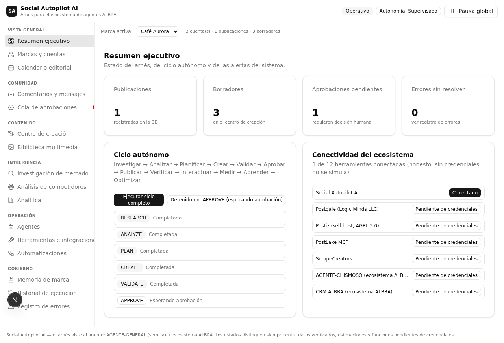
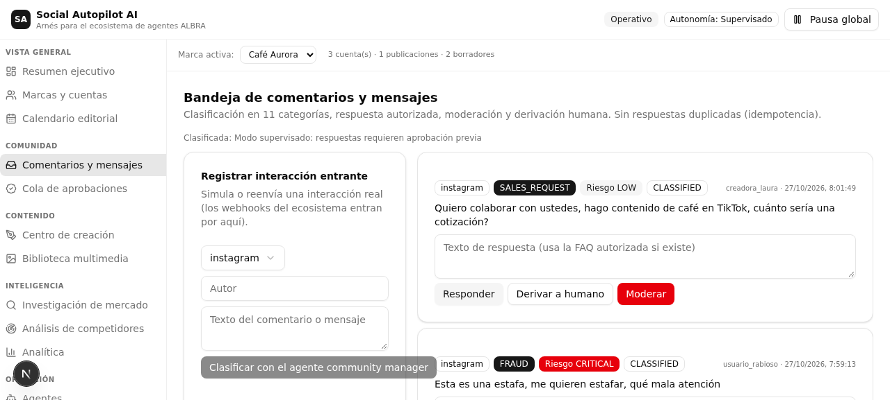
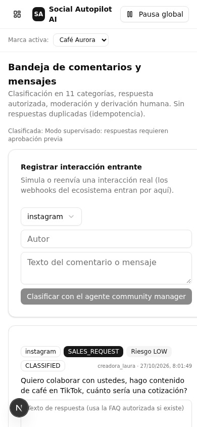

# COMUNITI-MANAGER · Social Autopilot AI

> Arnés (harness) de community management con IA para el agente **AGENTE-GENERAL**
> y el ecosistema ALBRA8. Construido con el método sala limpia de ClonaKit:
> inspirado funcionalmente en 20 referentes del sector, con **cero código copiado**.

## Qué es

Un chaleco de gobierno y operación para agentes de IA que gestionan comunidades
en redes sociales, en español: orquestador central, 14 agentes especializados,
memoria de marca aislada, registro de herramientas con estados honestos, ciclo
autónomo de 12 fases, aprobaciones humanas (HITL), pausa global, auditoría
append-only e idempotencia anti-duplicado.

**Metáfora del producto**: el agente es el músculo; el arnés es el chaleco con
los controles. Sin chaleco, el músculo no sabe qué hacer hoy, ni cuándo, ni con
qué límites, ni cómo se midió.

### Principio rector: no duplicar

Este arnés **no reimplementa** lo que el ecosistema ALBRA8 ya hace — lo orquesta
y consume:

| Función | La hace | Cómo se conecta |
|---|---|---|
| Escucha social / inteligencia | AGENTE-CHISMOSO | REST + mesh de agentes |
| Mensajería, CRM, automations | CRM-ALBRA | `/api/crm/actions` + MCP (16 tools) |
| Prospección B2B y outreach | AGENTE-LEADS | Webhook firmado |
| Difusión masiva WhatsApp | WHATSPOWER-ULTRA | API HTTP (escudo anti-ban) |
| Generación de assets | AGENTE-KREA | Rutas `/api/generate/*` |
| Producción de vídeo YouTube | YOUTUBE-AUTOMATION | A2A `/api/agent/execute` (25 tools MCP) |
| Investigación de nichos | NEX-SCOPE | MCP (12 tools) |

Lo que el arnés añade: publicación multi-red (IG/FB/TikTok/X/LinkedIn) programada automáticamente, comentarios
públicos, analítica cross-red, calendario editorial, memoria de marca con biblioteca de habilidades versionadas
(SKILL.md) y el ciclo de gobierno con aprobación humana.

## Capturas

| Panel | Comunidad | Móvil |
|---|---|---|
|  |  |  |

## Estructura del repo

```
COMUNITI-MANAGER/
├── FICHA.md                 Especificación funcional (fuente única de la construcción)
├── docs/
│   ├── research/REFERENTES_20.md      Informe comparativo de 20 referentes + ALBRA8
│   ├── architecture/ARCHITECTURE.md   Arquitectura del arnés
│   ├── architecture/INTEGRATIONS.md   Contratos de integración con el ecosistema
│   └── capturas/                      Capturas del panel
├── especializacion-albra/   Chaleco Python para la semilla ALBRA
│                            (identidad, tools, skills, workflow, políticas, memoria, prompts)
└── app/                     El arnés: panel Next.js 16 + motor TypeScript + Prisma/SQLite
```

## Arranque local

Requisitos: Node 20+ (o Bun) y SQLite.

```bash
cd app
npm install           # o bun install
npm run db:push       # crea la base de datos SQLite
npm run dev           # panel en http://localhost:3000
```

Variables opcionales (`.env`) — sin ellas las herramientas quedan
`AWAITING_CREDENTIALS` de forma honesta (nada se simula). Ver
[`app/.env.example`](app/.env.example) para la lista completa:

```env
ALBRA_SEED_URL=            ALBRA_SEED_TOKEN=
CRM_ALBRA_URL=             CRM_ALBRA_API_KEY=
CHISMOSO_URL=              LEADS_WEBHOOK_SECRET=
WHATPOWER_URL=             KREA_URL=            KREA_API_KEY=
YTAUTO_URL=                NEXSCOPE_URL=
POSTGALE_URL=              POSTGALE_API_KEY=    POSTGALE_WEBHOOK_SECRET=
POSTIZ_URL=                POSTIZ_API_KEY=
POSTLAKE_URL=              POSTLAKE_API_KEY=
SCRAPECREATORS_API_KEY=    HARNESS_WEBHOOK_SECRET=
```

## Uso en 4 pasos

1. **Marcas y cuentas** — crea tu marca: identidad, tono, vocabulario, palabras prohibidas, políticas, FAQs y horarios.
2. **Automatizaciones** — programa el ciclo diario por marca (hora local + zona horaria + días); el arnés lo dispara solo, respeta la pausa global y no se duplica.
3. **Cola de aprobaciones** — decide con motivo; el ciclo continúa hasta PUBLICAR (honesto: sin conector → `pendiente de conector`).
4. **Comentarios y mensajes** — clasifica interacciones; responde, deriva o modera según política y nivel de autonomía. Las habilidades (SKILL.md) que creas en Memoria de marca guían a los agentes.

## Arquitectura en una mirada

- **Motor** (`app/src/lib`): `contracts` (21 contratos con riesgo por acción), `registry` (herramientas con estados honestos), `agents` (14 agentes con firewall de contratos), `executor` (firewall + auditoría + idempotencia), `brand-memory` (vocabulario, precios, promesas, FAQs), `orchestrator` + `cycle` (12 fases, reintentos con backoff, pausa global), `scheduler` (ciclo diario programado por marca con zona horaria y anti-duplicado), `skills` (biblioteca SKILL.md versionada), `webhook-security` (verificación HMAC-SHA256 de webhooks entrantes).
- **Arranque** (`app/src/instrumentation.ts`): el bucle del scheduler (tick cada 60 s) arranca con el servidor; alternativamente un cron externo puede llamar `POST /api/scheduler {action:tick}` firmado.
- **APIs** (`app/src/app/api`): brands, drafts, orchestrator, approvals, community, research, calendar, analytics, webhooks, errors, audit, harness (doctor/pausa/modo), scheduler, skills.
- **UI** (`app/src/app` + `components/sections`): panel en español con las 18 secciones del PRD.
- **Especialización Python** (`especializacion-albra/`): capa que viste a AGENTE-GENERAL sin tocar su código (`albra_seed` invariante).

## Seguridad

- Niveles de autonomía L1/L2/L3 con pausa global: `autonomía ≠ permiso`.
- Firewall por agente (lista cerrada de contratos) y auditoría append-only.
- Idempotencia en toda acción externa: las publicaciones nunca se duplican.
- Aislamiento estricto de datos por marca; secretos solo por variables de entorno.

## Legal

- Construcción **sala limpia** desde `FICHA.md`: la investigación se consultó solo antes de escribir la especificación; ningún código de los referentes fue visto o copiado.
- Postiz es AGPL-3.0: solo se contempla operar una instancia propia por API; nada de su código se usa aquí.
- Las marcas de los referentes son de sus titulares; se citan únicamente como inspiración funcional.
- ClonaKit (MIT) se usó como metodología de construcción, no como dependencia de ejecución.
